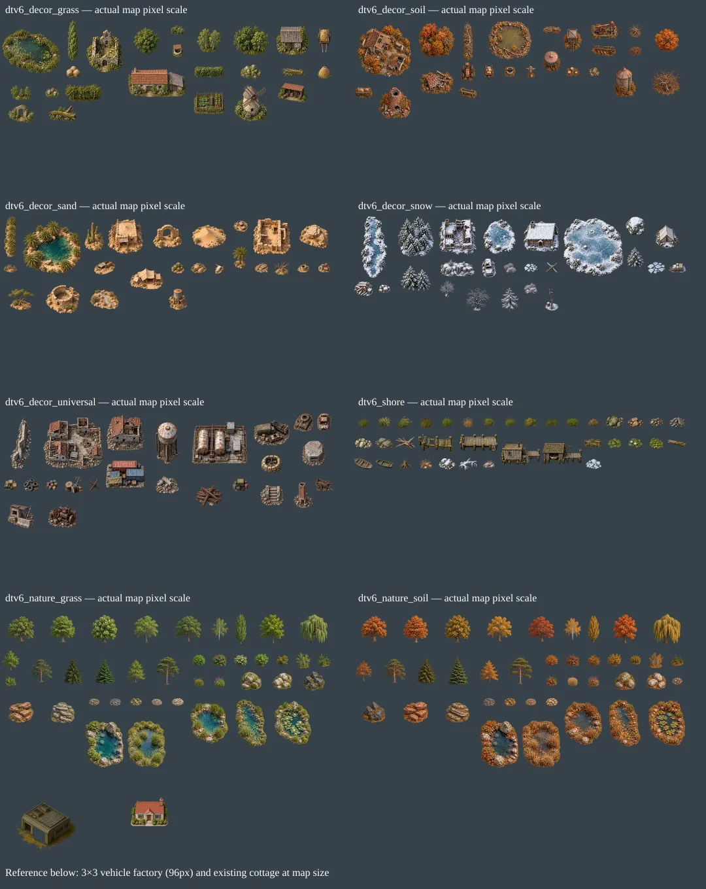

# dtv6 scale review — 2026-10-24

All eight sources were visually reviewed. Generated illustrations previously imported at 1:1, despite being drawn at inconsistent object scales. Each prop now fits an authored reference rectangle without changing its aspect ratio. Original sources and component bounds remain intact.

Reference grid: 64 px in atlases = 32 px on the map. The existing vehicle factory is 192×192 atlas px / 96×96 map px, with a 3×3 tile footprint. Existing dtv4 individual trees have median widths around 65 px; dtv5 cottages are about 112–128 px wide. New individual trees target 36–84 px (large groves may be wider); crates/barrels 36 px, cars/tractors 44–48 px, boats 52–56 px, huts about 104–108 px, and large farm/ruin/water landmarks at most 188 px.

Ratios below are import-time source-to-target factors, not runtime zoom. Source WebP hashes, SSE detection settings, exact numeric ratios, reference bounds, original bounding boxes and target render rectangles are stored in each JSON. WebP quality remains 85 with alpha quality 100.

| Sheet | Sprites | Min/max ratio | Atlas tiles |
|---|---:|---|---|
| dtv6_decor_grass | 24 | 0.181–0.559 | 16×5 |
| dtv6_decor_soil | 24 | 0.159–0.494 | 16×5 |
| dtv6_decor_sand | 24 | 0.148–0.505 | 16×5 |
| dtv6_decor_snow | 24 | 0.172–0.565 | 16×5 |
| dtv6_decor_universal | 24 | 0.186–0.636 | 16×6 |
| dtv6_shore | 36 | 0.155–0.511 | 16×3 |
| dtv6_nature_grass | 40 | 0.181–0.621 | 16×8 |
| dtv6_nature_soil | 40 | 0.173–0.634 | 16×8 |

## dtv6_decor_grass

| Sprite | Source px | Reference bounds px | Result px | Ratio | Footprint tiles |
|---|---|---|---|---:|---|
| grass_reed_pond | 426×331 | 180×188 | 180×140 | 0.4225 | 3×3 |
| grass_poplar_row | 100×342 | 40×124 | 36×124 | 0.3626 | 1×2 |
| grass_ruined_chapel | 215×244 | 116×160 | 116×132 | 0.5395 | 2×3 |
| grass_broad_oak | 234×235 | 80×124 | 80×80 | 0.3419 | 2×2 |
| grass_bushes | 243×173 | 44×124 | 44×31 | 0.1811 | 1×1 |
| grass_birches | 209×205 | 76×124 | 76×75 | 0.3636 | 2×2 |
| grass_oak_copse | 285×235 | 112×124 | 112×92 | 0.3930 | 2×2 |
| grass_wooden_shed | 186×163 | 104×152 | 104×91 | 0.5591 | 2×2 |
| grass_farmstead | 403×202 | 180×152 | 180×90 | 0.4467 | 3×2 |
| grass_hay_cart | 106×188 | 42×100 | 42×74 | 0.3962 | 1×2 |
| grass_stone_well | 142×162 | 36×152 | 36×41 | 0.2535 | 1×1 |
| grass_hedgerow | 280×107 | 92×100 | 92×35 | 0.3286 | 2×1 |
| grass_mossy_boulders | 226×159 | 64×100 | 64×45 | 0.2832 | 2×1 |
| grass_hay_bales | 194×157 | 44×100 | 44×36 | 0.2268 | 1×1 |
| grass_fallen_trunk | 325×126 | 72×100 | 72×28 | 0.2215 | 2×1 |
| grass_saplings | 225×161 | 64×124 | 64×46 | 0.2844 | 2×1 |
| grass_haystack | 181×185 | 42×100 | 42×43 | 0.2320 | 1×1 |
| grass_beehives | 235×167 | 44×100 | 44×31 | 0.1872 | 1×1 |
| grass_apple_orchard | 328×156 | 116×100 | 116×55 | 0.3537 | 2×1 |
| grass_vegetable_garden | 235×170 | 96×100 | 96×69 | 0.4085 | 2×2 |
| grass_windmill | 196×213 | 104×152 | 104×113 | 0.5306 | 2×2 |
| grass_tool_shed | 255×167 | 92×152 | 92×60 | 0.3608 | 2×1 |
| grass_broken_arch | 254×180 | 80×160 | 80×57 | 0.3150 | 2×1 |
| grass_mossy_logs | 268×150 | 88×100 | 88×49 | 0.3284 | 2×1 |

## dtv6_decor_soil

| Sprite | Source px | Reference bounds px | Result px | Ratio | Footprint tiles |
|---|---|---|---|---:|---|
| soil_ruined_farmstead | 354×339 | 176×160 | 167×160 | 0.4720 | 3×3 |
| soil_autumn_grove | 261×251 | 112×124 | 112×108 | 0.4291 | 2×2 |
| soil_dead_tree_row | 89×332 | 58×124 | 33×124 | 0.3735 | 1×2 |
| soil_muddy_pond | 267×244 | 132×188 | 132×121 | 0.4944 | 3×2 |
| soil_log_pile | 230×96 | 56×100 | 56×23 | 0.2435 | 1×1 |
| soil_watchtower | 165×189 | 60×160 | 60×69 | 0.3636 | 1×2 |
| soil_pumpjack | 204×130 | 88×160 | 88×56 | 0.4314 | 2×1 |
| soil_dead_tree | 222×213 | 48×124 | 48×46 | 0.2162 | 1×1 |
| soil_autumn_tree | 219×210 | 76×124 | 76×73 | 0.3470 | 2×2 |
| soil_fence_plough | 297×138 | 76×100 | 76×35 | 0.2559 | 2×1 |
| soil_water_tank | 179×203 | 56×120 | 56×64 | 0.3128 | 1×2 |
| soil_collapsed_shed | 247×174 | 104×160 | 104×73 | 0.4211 | 2×2 |
| soil_thornbush | 228×178 | 40×124 | 40×31 | 0.1754 | 1×1 |
| soil_rusty_tractor | 162×197 | 48×120 | 48×58 | 0.2963 | 1×1 |
| soil_wheelbarrow | 131×180 | 32×100 | 32×44 | 0.2443 | 1×1 |
| soil_stone_well | 197×178 | 36×152 | 36×33 | 0.1827 | 1×1 |
| soil_scarecrow | 164×183 | 32×100 | 32×36 | 0.1951 | 1×1 |
| soil_tree_stumps | 237×175 | 40×100 | 40×30 | 0.1688 | 1×1 |
| soil_loose_stones | 226×178 | 36×100 | 36×28 | 0.1593 | 1×1 |
| soil_grain_silo | 183×234 | 72×152 | 72×92 | 0.3934 | 2×2 |
| soil_bare_orchard | 250×217 | 96×100 | 96×83 | 0.3840 | 2×2 |
| soil_hay_wagon | 235×146 | 56×100 | 56×35 | 0.2383 | 1×1 |
| soil_brick_kiln | 240×233 | 100×160 | 100×97 | 0.4167 | 2×2 |
| soil_irrigation_trough | 249×157 | 56×100 | 56×35 | 0.2249 | 1×1 |

## dtv6_decor_sand

| Sprite | Source px | Reference bounds px | Result px | Ratio | Footprint tiles |
|---|---|---|---|---:|---|
| sand_palm_row | 123×367 | 96×124 | 42×124 | 0.3379 | 1×2 |
| sand_oasis | 395×353 | 180×188 | 180×161 | 0.4557 | 3×3 |
| sand_saguaros | 159×229 | 60×124 | 60×86 | 0.3774 | 1×2 |
| sand_adobe_hut | 214×212 | 108×152 | 108×107 | 0.5047 | 2×2 |
| sand_sandstone_arch | 216×179 | 88×160 | 88×73 | 0.4074 | 2×2 |
| sand_dune | 242×166 | 104×100 | 104×71 | 0.4298 | 2×2 |
| sand_car_wreck | 210×163 | 44×120 | 44×34 | 0.2095 | 1×1 |
| sand_mudbrick_ruin | 257×247 | 116×160 | 116×111 | 0.4514 | 2×2 |
| sand_sandstone_outcrop | 304×252 | 88×100 | 88×73 | 0.2895 | 2×2 |
| sand_palm | 175×228 | 52×124 | 52×68 | 0.2971 | 1×2 |
| sand_truck_wreck | 218×141 | 64×120 | 64×41 | 0.2936 | 2×1 |
| sand_tent_camp | 269×178 | 100×152 | 100×66 | 0.3717 | 2×2 |
| sand_dry_shrubs | 242×168 | 40×124 | 40×28 | 0.1653 | 1×1 |
| sand_barrel_cacti | 181×152 | 40×124 | 40×34 | 0.2210 | 1×1 |
| sand_loose_boulders | 254×171 | 48×100 | 48×32 | 0.1890 | 1×1 |
| sand_skull_bones | 134×172 | 28×100 | 28×36 | 0.2090 | 1×1 |
| sand_skeleton | 206×159 | 40×100 | 40×31 | 0.1942 | 1×1 |
| sand_dead_tree | 240×201 | 52×124 | 52×44 | 0.2167 | 1×1 |
| sand_stone_well | 244×195 | 36×152 | 36×29 | 0.1475 | 1×1 |
| sand_barrels | 207×164 | 36×120 | 36×29 | 0.1739 | 1×1 |
| sand_acacia | 258×213 | 80×124 | 80×66 | 0.3101 | 2×2 |
| sand_ruined_cistern | 221×184 | 104×160 | 104×87 | 0.4706 | 2×2 |
| sand_dry_wash | 258×180 | 88×100 | 88×61 | 0.3411 | 2×2 |
| sand_water_tank | 194×223 | 56×120 | 56×64 | 0.2887 | 1×2 |

## dtv6_decor_snow

| Sprite | Source px | Reference bounds px | Result px | Ratio | Footprint tiles |
|---|---|---|---|---:|---|
| snow_frozen_stream | 145×333 | 96×188 | 82×188 | 0.5646 | 2×3 |
| snow_pine_grove | 240×271 | 116×124 | 110×124 | 0.4576 | 2×2 |
| snow_ruined_house | 269×255 | 116×160 | 116×110 | 0.4312 | 2×2 |
| snow_frozen_pond | 179×190 | 100×188 | 100×106 | 0.5587 | 2×2 |
| snow_log_cabin | 202×177 | 108×152 | 108×95 | 0.5347 | 2×2 |
| snow_frozen_lake | 346×334 | 184×188 | 184×178 | 0.5318 | 3×3 |
| snow_boulder | 160×154 | 60×100 | 60×58 | 0.3750 | 1×1 |
| snow_expedition_tent | 190×190 | 72×152 | 72×72 | 0.3789 | 2×2 |
| snow_pine | 165×205 | 52×124 | 52×65 | 0.3152 | 1×2 |
| snow_spruces | 210×180 | 92×124 | 92×79 | 0.4381 | 2×2 |
| snow_rock_ridge | 304×157 | 104×100 | 104×54 | 0.3421 | 2×1 |
| snow_car_wreck | 143×187 | 44×120 | 44×58 | 0.3077 | 1×1 |
| snow_frosty_shrubs | 209×176 | 40×124 | 40×34 | 0.1914 | 1×1 |
| snow_loose_stones | 223×144 | 40×100 | 40×26 | 0.1794 | 1×1 |
| snow_iron_tank | 136×123 | 36×120 | 36×33 | 0.2647 | 1×1 |
| snow_ice_chunks | 226×160 | 52×100 | 52×37 | 0.2301 | 1×1 |
| snow_supplies_sled | 247×137 | 52×100 | 52×29 | 0.2105 | 1×1 |
| snow_firewood | 198×158 | 56×100 | 56×45 | 0.2828 | 1×1 |
| snow_crates | 209×144 | 36×120 | 36×25 | 0.1722 | 1×1 |
| snow_bare_birch | 175×187 | 48×124 | 48×51 | 0.2743 | 1×1 |
| snow_bare_oak | 277×258 | 76×124 | 76×71 | 0.2744 | 2×2 |
| snow_larch | 189×246 | 56×124 | 56×73 | 0.2963 | 1×2 |
| snow_snowy_bush | 226×191 | 44×124 | 44×37 | 0.1947 | 1×1 |
| snow_weather_mast | 139×238 | 40×160 | 40×68 | 0.2878 | 1×2 |

## dtv6_decor_universal

| Sprite | Source px | Reference bounds px | Result px | Ratio | Footprint tiles |
|---|---|---|---|---:|---|
| universal_wall_ruin | 134×328 | 128×160 | 65×160 | 0.4878 | 2×3 |
| universal_village_block | 371×318 | 184×160 | 184×158 | 0.4960 | 3×3 |
| universal_house_ruin | 227×215 | 116×160 | 116×110 | 0.5110 | 2×2 |
| universal_water_tower | 140×253 | 72×160 | 72×130 | 0.5143 | 2×3 |
| universal_fuel_depot | 264×202 | 168×160 | 168×129 | 0.6364 | 3×3 |
| universal_truck_convoy | 285×199 | 112×120 | 112×78 | 0.3930 | 2×2 |
| universal_tank_hulk | 203×196 | 60×160 | 60×58 | 0.2956 | 1×1 |
| universal_pillbox | 168×180 | 72×160 | 72×77 | 0.4286 | 2×2 |
| universal_containers | 274×195 | 120×120 | 120×85 | 0.4380 | 2×2 |
| universal_sandbags | 218×180 | 64×160 | 64×53 | 0.2936 | 2×1 |
| universal_car_wreck | 149×183 | 44×120 | 44×54 | 0.2953 | 1×1 |
| universal_crates | 181×158 | 36×120 | 36×31 | 0.1989 | 1×1 |
| universal_tires | 222×185 | 48×120 | 48×40 | 0.2162 | 1×1 |
| universal_barrels | 194×174 | 36×120 | 36×32 | 0.1856 | 1×1 |
| universal_cable_drums | 243×222 | 56×120 | 56×51 | 0.2305 | 1×1 |
| universal_iron_tank | 170×179 | 36×120 | 36×38 | 0.2118 | 1×1 |
| universal_rubble | 256×193 | 72×160 | 72×54 | 0.2813 | 2×1 |
| universal_girders | 221×181 | 80×160 | 80×66 | 0.3620 | 2×2 |
| universal_generator | 218×171 | 48×120 | 48×38 | 0.2202 | 1×1 |
| universal_concrete_steps | 218×187 | 72×160 | 72×62 | 0.3303 | 2×2 |
| universal_brick_chimney | 185×244 | 60×160 | 60×79 | 0.3243 | 1×2 |
| universal_collapsed_cart | 231×176 | 56×160 | 56×43 | 0.2424 | 1×1 |
| universal_checkpoint | 241×225 | 80×160 | 80×75 | 0.3320 | 2×2 |
| universal_machinery | 241×191 | 88×120 | 88×70 | 0.3651 | 2×2 |

## dtv6_shore

| Sprite | Source px | Reference bounds px | Result px | Ratio | Footprint tiles |
|---|---|---|---|---:|---|
| universal_cattails | 194×194 | 36×56 | 36×36 | 0.1856 | 1×1 |
| universal_flowering_reeds | 224×196 | 40×56 | 40×35 | 0.1786 | 1×1 |
| universal_bent_reeds | 231×187 | 44×56 | 44×36 | 0.1905 | 1×1 |
| universal_dense_cattails | 218×190 | 40×56 | 40×35 | 0.1835 | 1×1 |
| universal_green_reeds | 231×198 | 36×56 | 36×31 | 0.1558 | 1×1 |
| universal_dry_reeds | 212×195 | 36×56 | 36×33 | 0.1698 | 1×1 |
| universal_flowering_sedge | 203×164 | 36×56 | 36×29 | 0.1773 | 1×1 |
| universal_rushes | 207×167 | 36×56 | 36×29 | 0.1739 | 1×1 |
| universal_grass_hummock | 223×165 | 40×56 | 40×30 | 0.1794 | 1×1 |
| universal_bank_rushes | 222×146 | 40×56 | 40×26 | 0.1802 | 1×1 |
| universal_broadleaf_sedge | 231×168 | 40×56 | 40×29 | 0.1732 | 1×1 |
| universal_dry_hummock | 232×167 | 36×56 | 36×26 | 0.1552 | 1×1 |
| universal_mossy_rocks | 230×151 | 56×56 | 56×37 | 0.2435 | 1×1 |
| universal_sandstone_pebbles | 227×140 | 48×56 | 48×30 | 0.2115 | 1×1 |
| universal_river_pebbles | 204×130 | 44×56 | 44×28 | 0.2157 | 1×1 |
| universal_slate_chips | 215×138 | 48×56 | 48×31 | 0.2233 | 1×1 |
| universal_pale_rocks | 228×141 | 52×56 | 52×32 | 0.2281 | 1×1 |
| universal_granite_bank | 226×131 | 56×56 | 56×32 | 0.2478 | 1×1 |
| universal_driftwood | 232×151 | 60×56 | 60×39 | 0.2586 | 1×1 |
| universal_broken_pier | 221×111 | 116×56 | 111×56 | 0.5045 | 2×1 |
| universal_jetty | 233×111 | 120×56 | 118×56 | 0.5045 | 2×1 |
| universal_fishing_hut | 235×139 | 120×88 | 120×71 | 0.5106 | 2×2 |
| universal_boathouse | 246×134 | 120×88 | 120×65 | 0.4878 | 2×2 |
| universal_bank_planks | 224×122 | 56×56 | 56×31 | 0.2500 | 1×1 |
| universal_lily_pads | 194×140 | 40×56 | 40×29 | 0.2062 | 1×1 |
| universal_water_lilies | 223×147 | 44×56 | 44×29 | 0.1973 | 1×1 |
| universal_pond_leaves | 186×147 | 40×56 | 40×32 | 0.2151 | 1×1 |
| universal_floating_log | 252×98 | 56×56 | 56×22 | 0.2222 | 1×1 |
| universal_rowing_boat | 220×129 | 56×56 | 56×33 | 0.2545 | 1×1 |
| universal_skiff | 204×103 | 52×56 | 52×26 | 0.2549 | 1×1 |
| universal_weathered_stump | 206×187 | 36×56 | 36×33 | 0.1748 | 1×1 |
| universal_snowy_reeds | 215×170 | 40×56 | 40×32 | 0.1860 | 1×1 |
| universal_snowy_rocks | 250×168 | 52×56 | 52×35 | 0.2080 | 1×1 |
| universal_icy_driftwood | 256×175 | 56×56 | 56×38 | 0.2188 | 1×1 |
| universal_snowy_grass | 228×164 | 40×56 | 40×29 | 0.1754 | 1×1 |
| universal_ice_rubble | 232×149 | 48×56 | 48×31 | 0.2069 | 1×1 |

## dtv6_nature_grass

| Sprite | Source px | Reference bounds px | Result px | Ratio | Footprint tiles |
|---|---|---|---|---:|---|
| grass_oak | 195×189 | 80×124 | 80×78 | 0.4103 | 2×2 |
| grass_beech | 176×190 | 76×124 | 76×82 | 0.4318 | 2×2 |
| grass_chestnut | 174×187 | 80×124 | 80×86 | 0.4598 | 2×2 |
| grass_ash | 178×193 | 76×124 | 76×82 | 0.4270 | 2×2 |
| grass_elm | 187×185 | 80×124 | 80×79 | 0.4278 | 2×2 |
| grass_birch | 164×221 | 52×124 | 52×70 | 0.3171 | 1×2 |
| grass_poplar | 88×225 | 36×124 | 36×92 | 0.4091 | 1×2 |
| grass_maple | 188×222 | 76×124 | 76×90 | 0.4043 | 2×2 |
| grass_willow | 193×206 | 84×124 | 84×90 | 0.4352 | 2×2 |
| grass_young_oak | 179×207 | 52×124 | 52×60 | 0.2905 | 1×1 |
| grass_pine | 206×214 | 68×124 | 68×71 | 0.3301 | 2×2 |
| grass_spruce | 154×217 | 60×124 | 60×85 | 0.3896 | 1×2 |
| grass_fir | 162×210 | 64×124 | 64×83 | 0.3951 | 2×2 |
| grass_larch | 180×215 | 60×124 | 60×72 | 0.3333 | 1×2 |
| grass_scots_pine | 180×215 | 72×124 | 72×86 | 0.4000 | 2×2 |
| grass_leafy_bush | 177×158 | 40×124 | 40×36 | 0.2260 | 1×1 |
| grass_bramble | 190×159 | 44×124 | 44×37 | 0.2316 | 1×1 |
| grass_hawthorn | 192×163 | 40×124 | 40×34 | 0.2083 | 1×1 |
| grass_hazel | 180×161 | 44×124 | 44×39 | 0.2444 | 1×1 |
| grass_gorse | 188×157 | 36×124 | 36×30 | 0.1915 | 1×1 |
| grass_birch_saplings | 156×176 | 44×124 | 44×50 | 0.2821 | 1×1 |
| grass_pine_saplings | 174×173 | 40×124 | 40×40 | 0.2299 | 1×1 |
| grass_ferns | 196×162 | 36×80 | 36×30 | 0.1837 | 1×1 |
| grass_tall_grass | 159×148 | 32×80 | 32×30 | 0.2013 | 1×1 |
| grass_wildflowers | 187×175 | 36×80 | 36×34 | 0.1925 | 1×1 |
| grass_granite | 185×158 | 64×80 | 64×55 | 0.3459 | 2×1 |
| grass_limestone | 185×155 | 60×80 | 60×50 | 0.3243 | 1×1 |
| grass_basalt | 189×167 | 68×80 | 68×60 | 0.3598 | 2×1 |
| grass_sandstone | 193×161 | 76×80 | 76×63 | 0.3938 | 2×2 |
| grass_layered_rocks | 182×163 | 72×80 | 72×64 | 0.3956 | 2×2 |
| grass_river_stones | 174×113 | 32×80 | 32×21 | 0.1839 | 1×1 |
| grass_slate_stones | 181×117 | 36×80 | 36×23 | 0.1989 | 1×1 |
| grass_mossy_stones | 176×112 | 36×80 | 36×23 | 0.2045 | 1×1 |
| grass_pebbles | 177×111 | 32×80 | 32×20 | 0.1808 | 1×1 |
| grass_pale_stones | 184×117 | 36×80 | 36×23 | 0.1957 | 1×1 |
| grass_reed_pond | 216×237 | 116×144 | 116×127 | 0.5370 | 2×3 |
| grass_woodland_pond | 170×254 | 128×144 | 96×144 | 0.5669 | 2×3 |
| grass_lily_pond | 201×238 | 112×144 | 112×133 | 0.5572 | 2×3 |
| grass_rocky_lake | 205×253 | 148×144 | 117×144 | 0.5692 | 2×3 |
| grass_wetland_pond | 190×232 | 124×144 | 118×144 | 0.6207 | 2×3 |

## dtv6_nature_soil

| Sprite | Source px | Reference bounds px | Result px | Ratio | Footprint tiles |
|---|---|---|---|---:|---|
| soil_oak | 192×189 | 80×124 | 80×79 | 0.4167 | 2×2 |
| soil_beech | 176×195 | 76×124 | 76×84 | 0.4318 | 2×2 |
| soil_chestnut | 179×191 | 80×124 | 80×85 | 0.4469 | 2×2 |
| soil_ash | 188×191 | 76×124 | 76×77 | 0.4043 | 2×2 |
| soil_elm | 195×189 | 80×124 | 80×78 | 0.4103 | 2×2 |
| soil_birch | 163×211 | 52×124 | 52×67 | 0.3190 | 1×2 |
| soil_poplar | 96×218 | 36×124 | 36×82 | 0.3750 | 1×2 |
| soil_maple | 183×215 | 76×124 | 76×89 | 0.4153 | 2×2 |
| soil_willow | 190×209 | 84×124 | 84×92 | 0.4421 | 2×2 |
| soil_young_oak | 174×212 | 52×124 | 52×63 | 0.2989 | 1×2 |
| soil_pine | 192×208 | 68×124 | 68×74 | 0.3542 | 2×2 |
| soil_spruce | 159×206 | 60×124 | 60×78 | 0.3774 | 1×2 |
| soil_fir | 149×206 | 64×124 | 64×88 | 0.4295 | 2×2 |
| soil_larch | 181×203 | 60×124 | 60×67 | 0.3315 | 1×2 |
| soil_scots_pine | 181×207 | 72×124 | 72×82 | 0.3978 | 2×2 |
| soil_leafy_bush | 187×152 | 40×124 | 40×33 | 0.2139 | 1×1 |
| soil_bramble | 178×157 | 44×124 | 44×39 | 0.2472 | 1×1 |
| soil_hawthorn | 169×159 | 40×124 | 40×38 | 0.2367 | 1×1 |
| soil_hazel | 186×163 | 44×124 | 44×39 | 0.2366 | 1×1 |
| soil_gorse | 189×163 | 36×124 | 36×31 | 0.1905 | 1×1 |
| soil_birch_saplings | 156×175 | 44×124 | 44×49 | 0.2821 | 1×1 |
| soil_pine_saplings | 194×176 | 40×124 | 40×36 | 0.2062 | 1×1 |
| soil_ferns | 187×160 | 36×80 | 36×31 | 0.1925 | 1×1 |
| soil_tall_grass | 165×160 | 32×80 | 32×31 | 0.1939 | 1×1 |
| soil_wildflowers | 185×169 | 36×80 | 36×33 | 0.1946 | 1×1 |
| soil_granite | 190×162 | 64×80 | 64×55 | 0.3368 | 2×1 |
| soil_limestone | 187×158 | 60×80 | 60×51 | 0.3209 | 1×1 |
| soil_basalt | 174×166 | 68×80 | 68×65 | 0.3908 | 2×2 |
| soil_sandstone | 188×162 | 76×80 | 76×65 | 0.4043 | 2×2 |
| soil_layered_rocks | 183×157 | 72×80 | 72×62 | 0.3934 | 2×2 |
| soil_river_stones | 176×123 | 32×80 | 32×22 | 0.1818 | 1×1 |
| soil_slate_stones | 178×123 | 36×80 | 36×25 | 0.2022 | 1×1 |
| soil_mossy_stones | 180×121 | 36×80 | 36×24 | 0.2000 | 1×1 |
| soil_pebbles | 185×124 | 32×80 | 32×21 | 0.1730 | 1×1 |
| soil_pale_stones | 186×126 | 36×80 | 36×24 | 0.1935 | 1×1 |
| soil_reed_pond | 202×234 | 116×144 | 116×134 | 0.5743 | 2×3 |
| soil_woodland_pond | 170×247 | 128×144 | 99×144 | 0.5830 | 2×3 |
| soil_lily_pond | 184×229 | 112×144 | 112×139 | 0.6087 | 2×3 |
| soil_rocky_lake | 198×244 | 148×144 | 117×144 | 0.5902 | 2×3 |
| soil_wetland_pond | 187×227 | 124×144 | 119×144 | 0.6344 | 2×3 |
