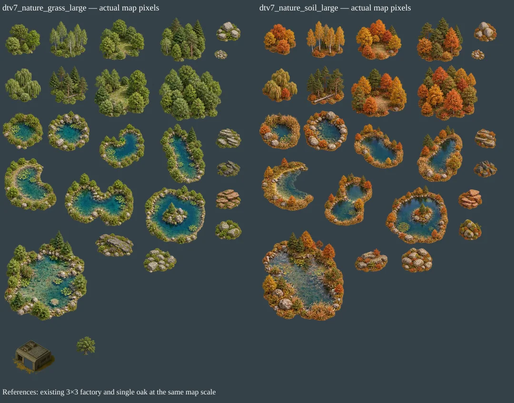

# Large grass and soil nature: scale review

Two new transparent sources supply 48 additional assets: eight woodland groups, eight lakes and eight rock/stone formations per biome. Grass uses green summer art; soil uses earthy autumn art. All cutouts were reviewed against existing ~65–80 px single trees, 112–128 px cottages and the 192×192 px vehicle factory. Atlas pitch 64 px renders at map pitch 32 px.

Large groups cover more ground and contain more normal-sized trees/rocks. Dense woods occupy 5×4 tiles, the broadest lake 6×6, medium boulder formations 2×2/3×2, and loose stone patches 1×1. A large lake is allowed to exceed the factory reference; the factory is not a universal asset-size maximum.

Some source panels compress many trees into one small illustration, so the explicit offline ratio ceiling is 2 for these two sources only. A single aspect-preserving ratio fits each reviewed reference rectangle. All original sources remain intact and all exact ratios/bounds are recorded in the JSON; there is no runtime zoom. Default dtv6 and city scales are unchanged.

## dtv7_nature_grass_large

| Sprite | Original px | Result px | Ratio | Tile footprint | Placement tags |
|---|---|---|---:|---|---|
| grass_broadleaf_copse | 232×205 | 149×132 | 0.6439 | 3×3 | grass, summer, decorative, trees, impassable |
| grass_birch_stand | 211×201 | 164×156 | 0.7761 | 3×3 | grass, summer, decorative, trees, impassable |
| grass_woodland_clearing | 234×212 | 190×172 | 0.8113 | 4×3 | grass, summer, decorative, trees, impassable |
| grass_mixed_grove | 240×235 | 192×188 | 0.8000 | 4×3 | grass, summer, decorative, trees, impassable |
| grass_willow_copse | 238×225 | 152×144 | 0.6400 | 3×3 | grass, summer, decorative, trees, impassable |
| grass_pine_log_grove | 230×226 | 167×164 | 0.7257 | 3×3 | grass, summer, decorative, trees, impassable |
| grass_curved_clearing | 240×207 | 237×204 | 0.9855 | 4×4 | grass, summer, decorative, trees, impassable |
| grass_dense_woodland | 241×215 | 265×236 | 1.0977 | 5×4 | grass, summer, decorative, trees, impassable |
| grass_reed_pond | 208×189 | 172×156 | 0.8254 | 3×3 | grass, summer, decorative, water, lake, impassable |
| grass_rocky_pond | 223×217 | 177×172 | 0.7926 | 3×3 | grass, summer, decorative, water, lake, impassable |
| grass_kidney_lake | 236×231 | 192×188 | 0.8139 | 4×3 | grass, summer, decorative, water, lake, impassable |
| grass_long_woodland_lake | 198×260 | 192×252 | 0.9692 | 4×4 | grass, summer, decorative, water, lake, impassable |
| grass_crescent_lake | 230×234 | 220×224 | 0.9573 | 4×4 | grass, summer, decorative, water, lake, impassable |
| grass_twin_lobed_lake | 241×185 | 292×224 | 1.2108 | 5×4 | grass, summer, decorative, water, lake, impassable |
| grass_island_lake | 248×241 | 255×248 | 1.0290 | 5×4 | grass, summer, decorative, water, lake, impassable |
| grass_broad_shallow_lake | 242×263 | 350×380 | 1.4449 | 6×6 | grass, summer, decorative, water, lake, impassable |
| grass_granite_boulders | 220×179 | 103×84 | 0.4693 | 2×2 | grass, summer, decorative, rocks, impassable |
| grass_limestone_shelves | 234×182 | 108×84 | 0.4615 | 2×2 | grass, summer, decorative, rocks, impassable |
| grass_basalt_formation | 232×159 | 100×69 | 0.4310 | 2×2 | grass, summer, decorative, rocks, impassable |
| grass_sandstone_slabs | 221×175 | 106×84 | 0.4800 | 2×2 | grass, summer, decorative, rocks, impassable |
| grass_river_stone_patch | 218×152 | 56×39 | 0.2569 | 1×1 | grass, summer, decorative, rocks, stones, passable |
| grass_mossy_boulders | 237×179 | 112×85 | 0.4726 | 2×2 | grass, summer, decorative, rocks, impassable |
| grass_low_rocky_ridge | 245×151 | 162×100 | 0.6623 | 3×2 | grass, summer, decorative, rocks, impassable |
| grass_fieldstone_formation | 238×177 | 140×104 | 0.5876 | 3×2 | grass, summer, decorative, rocks, stones, passable |

## dtv7_nature_soil_large

| Sprite | Original px | Result px | Ratio | Tile footprint | Placement tags |
|---|---|---|---:|---|---|
| soil_broadleaf_copse | 224×216 | 137×132 | 0.6111 | 3×3 | soil, autumn, decorative, trees, impassable |
| soil_birch_stand | 215×205 | 164×156 | 0.7610 | 3×3 | soil, autumn, decorative, trees, impassable |
| soil_woodland_clearing | 247×219 | 194×172 | 0.7854 | 4×3 | soil, autumn, decorative, trees, impassable |
| soil_mixed_grove | 233×223 | 196×188 | 0.8430 | 4×3 | soil, autumn, decorative, trees, impassable |
| soil_willow_copse | 233×225 | 149×144 | 0.6400 | 3×3 | soil, autumn, decorative, trees, impassable |
| soil_pine_log_grove | 212×216 | 161×164 | 0.7593 | 3×3 | soil, autumn, decorative, trees, impassable |
| soil_curved_clearing | 251×216 | 237×204 | 0.9444 | 4×4 | soil, autumn, decorative, trees, impassable |
| soil_dense_woodland | 234×217 | 254×236 | 1.0876 | 5×4 | soil, autumn, decorative, trees, impassable |
| soil_reed_pond | 212×190 | 174×156 | 0.8211 | 3×3 | soil, autumn, decorative, water, lake, impassable |
| soil_rocky_pond | 230×211 | 187×172 | 0.8152 | 3×3 | soil, autumn, decorative, water, lake, impassable |
| soil_kidney_lake | 262×236 | 209×188 | 0.7966 | 4×3 | soil, autumn, decorative, water, lake, impassable |
| soil_long_woodland_lake | 215×268 | 192×239 | 0.8930 | 4×4 | soil, autumn, decorative, water, lake, impassable |
| soil_crescent_lake | 232×236 | 220×224 | 0.9492 | 4×4 | soil, autumn, decorative, water, lake, impassable |
| soil_twin_lobed_lake | 224×249 | 202×224 | 0.8996 | 4×4 | soil, autumn, decorative, water, lake, impassable |
| soil_island_lake | 281×262 | 266×248 | 0.9466 | 5×4 | soil, autumn, decorative, water, lake, impassable |
| soil_broad_shallow_lake | 254×279 | 346×380 | 1.3620 | 6×6 | soil, autumn, decorative, water, lake, impassable |
| soil_granite_boulders | 234×201 | 98×84 | 0.4179 | 2×2 | soil, autumn, decorative, rocks, impassable |
| soil_limestone_shelves | 221×204 | 91×84 | 0.4118 | 2×2 | soil, autumn, decorative, rocks, impassable |
| soil_basalt_formation | 253×184 | 100×73 | 0.3953 | 2×2 | soil, autumn, decorative, rocks, impassable |
| soil_sandstone_slabs | 235×195 | 101×84 | 0.4308 | 2×2 | soil, autumn, decorative, rocks, impassable |
| soil_river_stone_patch | 221×169 | 56×43 | 0.2534 | 1×1 | soil, autumn, decorative, rocks, stones, passable |
| soil_mossy_boulders | 220×202 | 96×88 | 0.4356 | 2×2 | soil, autumn, decorative, rocks, impassable |
| soil_low_rocky_ridge | 248×179 | 139×100 | 0.5587 | 3×2 | soil, autumn, decorative, rocks, impassable |
| soil_fieldstone_formation | 233×187 | 130×104 | 0.5561 | 3×2 | soil, autumn, decorative, rocks, stones, passable |
