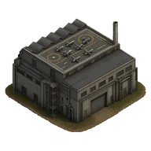
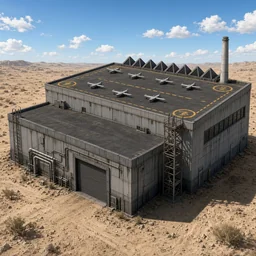
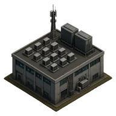
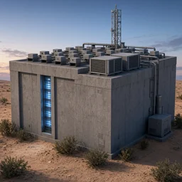
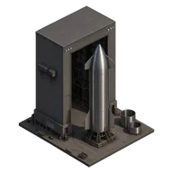
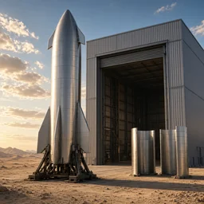
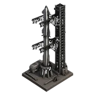
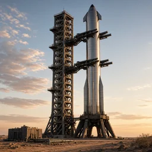

# Spec 139: Technology Center (draft)

**Branch:** `dev`  
**Status:** Draft — open questions must be decided before implementation  
**Created:** 2026-11-21 (Europe/Berlin)  
**Last Updated:** 2026-11-22 (Europe/Berlin)  
**Source:** voice-call discussion on 2026-11-21; existing unused art already in the repo

This is a **draft**. Do not invent costs, prerequisites, footprints, or gameplay effects to fill gaps. Resolve the Open questions section with Patrick before writing production code.

---

## Overview

The **Technology Center** is a late-game research building. Unused art already exists in the repo, and the multi-player AI spec already treats a Tech Center as the prerequisite for "advanced structures" ([Spec 007 FR-013](../007-multi-player-ai-system/spec.md)). The building itself is **not implemented**: nothing in production, tech-tree, or building data references it. `src/game/attackNotifications.js` lists a leftover type id `techCenter` among base buildings, but no building uses that type today.

Patrick's direction from the 2026-11-21 discussion: the Technology Center is the unlock gate for four later buildings:

1. **Drone Factory**
2. **AI Center** (an AI data center)
3. **Rocket Launch Base** — a launch tower styled like SpaceX's launch tower "Mechazilla", with the rocket / Starship
4. **Spaceship Factory**

What each of those four buildings enables, what they cost, which other prerequisites they need, and their gameplay purpose are **not decided**.

A related, broader improvement already on the list is a data-driven tech tree: [TODO/Improvements.md](../../TODO/Improvements.md) still has an open item to "Add a JSON file that determines the whole tech tree. Refactor the code to obey this file." That work is complementary, not a substitute for this building spec, and is not in scope until Patrick says otherwise.

---

## Current repo facts

### Art already present

These files exist and are unused by gameplay code:

| Role | Path | Measured size |
|---|---|---|
| Map sprite | `public/images/map/buildings/technology_research_center_map.webp` | 192×192 RGBA |
| Sidebar / build-button icon | `public/images/sidebar/technology_research_center_sidebar.webp` | 256×256 RGB |
| Prepared 1x / 2x / 3x | `public/images/prepared/building/technologyResearchCenter/base@1x.webp` (96×96), `base@2x.webp` (192×192), `base@3x.webp` (288×288) | RGBA |

`scripts/build-prepared-sprites.mjs` already has an entry `['technologyResearchCenter', 'technology_research_center_map.webp', 3, 3]`. The 192×192 map sprite matches the older 3×3 convention of 64 px per tile (see `specs/command-center-perks.md` §3.1).

`docs/BuildingImageAssetGenerationPromptTemplate.md` ends with a prompt to generate a technology research center at a **2×3** footprint. That disagrees with the prepared-sprite entry and with the 192×192 bitmap. The footprint is an open question.

### Type-id inconsistency

- Prepared-sprite id / folder: `technologyResearchCenter`
- Attack-notification leftover: `techCenter`
- Display names in docs and conversation: "Technology Center", "Tech Center", "technology research center"

Pick one canonical type id and display name before implementation. Do not leave both `techCenter` and `technologyResearchCenter` in circulation.

### Mentions, not implementations

- [Spec 007 FR-013](../007-multi-player-ai-system/spec.md): AI must respect technology-tree prerequisites, "e.g., Advanced structures require Tech Center".
- `src/game/attackNotifications.js`: `'techCenter'` is listed as a player base structure for under-attack notifications.
- Command Center perk research notes (`specs/command-center-perks.md` §3.1) already flag the unused Technology Center art as a style reference. That note is historical; this spec is the building's own draft.

The four follow-on buildings now have committed map and sidebar art (see [Art assets](#art-assets)). They still have no type ids or gameplay code.

---

## User Stories

### User Story 1: Build a Technology Center

**Priority:** P0  
**As a** player  
**I want** to construct a Technology Center once its (still undecided) prerequisites are met  
**So that** I can unlock the next tier of late-game buildings

**Acceptance Criteria:**

- [ ] The Technology Center is a placeable building in the production UI once its prerequisites are satisfied, and is locked until then.
- [ ] It uses the existing map, sidebar, and prepared-sprite art listed above unless Patrick decides to replace that art.
- [ ] It has a decided footprint, cost, build time, power use, health, and any other stats that other buildings have; those values are recorded in this spec after Patrick decides them (they are not filled in here).
- [ ] Under-attack notifications treat it as a base structure (the leftover `techCenter` entry is reconciled with the canonical type id).
- [ ] It is documented in the user manual and wired through the usual new-building checklist (`skills/new-building/SKILL.md` and the list in `specs/command-center-perks.md` §3.1).

---

### User Story 2: Unlock the four advanced buildings

**Priority:** P0  
**As a** player  
**I want** the Technology Center to be the gate for the Drone Factory, AI Center, Rocket Launch Base, and Spaceship Factory  
**So that** late-game options appear only after I have invested in research infrastructure

**Acceptance Criteria:**

- [ ] None of the four follow-on buildings can be placed until the player has a living Technology Center, plus any further prerequisites Patrick decides.
- [ ] Each of the four buildings has a decided purpose, cost, footprint, and set of unlocks or abilities, recorded in this spec or in a later follow-up spec after those decisions.
- [ ] Losing the Technology Center has a decided effect on already-unlocked buildings and in-flight production (see Open questions).
- [ ] The four buildings are not shipped as empty placeholders: each ships only when its gameplay purpose is decided and, if it needs new art, when that art is approved.

---

### User Story 3: Art and presentation

**Priority:** P1  
**As a** player  
**I want** the new buildings to look consistent with the rest of the base  
**So that** the late-game tier reads as part of the same world

**Acceptance Criteria:**

- [ ] Any **new** game-asset images (map sprite, build-button icon, construction icon) are generated with **Grok Imagine only**, never ChatGPT, OpenAI, or any other image model. This is a standing rule for all future code-for-battle game-asset images, not only this building.
- [ ] New art is shown to Patrick as previews and approved before anything is committed. For new buildings the usual two-stage flow applies: map-sprite proposals first, then build-button proposals, then implementation (`skills/new-building/SKILL.md`).
- [x] The Rocket Launch Base, AI Center, Drone Factory, and Spaceship Factory map and build-button art was picked on 2026-11-21 and is listed under [Art assets](#art-assets). Gameplay meaning of each building is still open.
- [ ] The Rocket Launch Base remains a launch tower in the style of SpaceX's "Mechazilla", with the rocket / Starship as part of the building. Whether the rocket is decorative or a unit is not decided.
- [ ] The AI Center is visually an AI data center.
- [ ] Existing Technology Center art may be kept or replaced; that choice is open. If it is kept, no new generation is required for that building.

---

## Functional Requirements

### FR-001: Technology Center is a real building

**Priority:** P0  
**Description:** Add the Technology Center to building data, production, the tech tree, tooltips, saves, multiplayer sync, the user manual, and the other wiring called out by `skills/new-building/SKILL.md`. It is not only art in `public/images/`.

### FR-002: Existing art is the default until a replacement is approved

**Priority:** P0  
**Description:** Implementation uses the existing `technology_research_center_*` and prepared `technologyResearchCenter` assets unless Patrick approves new Grok Imagine art. Do not commit replacement images without approval.

### FR-003: Canonical type id and display name

**Priority:** P0  
**Description:** One type id and one player-facing name are used everywhere (building data, tech tree, AI API, notifications, manual, landing copy). The unused `techCenter` notification entry is migrated or removed so it cannot drift.

### FR-004: Technology Center unlocks the four named buildings

**Priority:** P0  
**Description:** The Drone Factory, AI Center (AI data center), Rocket Launch Base, and Spaceship Factory all require a Technology Center. Further prerequisites, mutual order among the four, and what each building produces or enables are not specified here.

### FR-005: Rocket Launch Base visual direction

**Priority:** P1  
**Description:** When the Rocket Launch Base is designed and drawn, its map presence is a launch tower styled like SpaceX's "Mechazilla", including the rocket / Starship. This does not decide whether the rocket is a decorative part of the building, a produced unit, or a triggered superweapon.

### FR-006: New-asset art rule

**Priority:** P0  
**Description:** New map sprites, build-button icons, and construction icons for these buildings (and for any future game assets) are generated with Grok Imagine only, previewed to Patrick, and approved before commit.

### FR-007: AI respects the Tech Center prerequisite

**Priority:** P1  
**Description:** Consistent with [Spec 007 FR-013](../007-multi-player-ai-system/spec.md), an AI that is allowed to build any of the four follow-on buildings must build or already have a Technology Center first. Whether the AI should build this tier at all is an open question.

### FR-008: Do not invent balance numbers

**Priority:** P0  
**Description:** Costs, hit points, power, build times, footprints (except the unresolved 2×3 vs 3×3 evidence above), production lists, and damage values are left blank until Patrick decides them. Implementation must not fill those in ad hoc.

---

## Success Criteria

### SC-001: The Technology Center can be built in a match
Once prerequisites and stats are decided, a player can place a Technology Center, it appears on the map with the chosen art and footprint, and it is saved, loaded, and synced like other buildings.

### SC-002: The four follow-on buildings stay locked without it
Drone Factory, AI Center, Rocket Launch Base, and Spaceship Factory cannot be started without a Technology Center (and any other decided prerequisites).

### SC-003: No silent stats
Every numeric or gameplay value that ships is written into this spec or a dated amendment after Patrick's decision.

### SC-004: Art approval
Follow-on building map sprites and build buttons were picked on 2026-11-21 (see Art assets). Further new images still need a Grok Imagine preview and Patrick's explicit pick.

---

## To-do checklist

Use this list to continue the work in a later session. Check items off only when the work is done or the question is decided and recorded.

### Decisions (block implementation of the affected part)

- [ ] Confirm the player-facing name and canonical type id (`technologyResearchCenter` vs `techCenter` vs something else).
- [ ] Confirm the Technology Center footprint (2×3 vs 3×3; see Current repo facts) and whether the existing 192×192 map sprite is kept.
- [ ] Decide Technology Center cost, build time, power, health, and other building stats, plus its own prerequisites (for example Radar, Construction Yard, or something else).
- [ ] Decide what happens if the Technology Center is sold or destroyed after later buildings exist.
- [ ] For **Drone Factory**: gameplay purpose, what it produces or enables, cost, footprint, extra prerequisites, art direction.
- [ ] For **AI Center**: gameplay purpose, what it produces or enables, cost, footprint, extra prerequisites, art direction (data-center look is already requested).
- [ ] For **Rocket Launch Base**: gameplay purpose (decorative landmark vs produced rocket/Starship unit vs launch ability), cost, footprint, extra prerequisites; keep the Mechazilla + rocket visual direction.
- [ ] For **Spaceship Factory**: gameplay purpose, what it produces or enables, cost, footprint, extra prerequisites, art direction.
- [ ] Decide whether the AI builds this tier, and if so under which conditions.
- [ ] Decide whether this work should land together with, or stay separate from, the JSON tech-tree refactor in `TODO/Improvements.md`.

### Implementation (after the decisions above)

- [ ] Write decided values back into this spec (move them out of Open questions) before or with the implementation commit.
- [x] Commit the picked follow-on map sprites and build buttons (done 2026-11-21; see Art assets). Construction icons were not requested.
- [ ] Implement the Technology Center via `skills/new-building/SKILL.md`.
- [ ] Implement each follow-on building only after its purpose and art (if new) are approved. Prefer separate follow-up specs if a building grows its own systems (drones, launches, spaceships).
- [ ] Reconcile `attackNotifications.js` with the canonical type id.
- [ ] Add user-manual and landing-page coverage.
- [ ] Tests: placement, prerequisites, save/load, multiplayer sync, AI prerequisite behaviour if the AI is allowed to build this tier.

---

## Art assets

Patrick picked the follow-on building art on 2026-11-21 (Europe/Berlin). Every image below was generated with **Grok Imagine** only. The files are committed as unused assets: this change does not register them in production, the tech tree, or `scripts/build-prepared-sprites.mjs`. No construction-yard icons were made for these buildings.

| Building | Map sprite (192×192 RGBA) | Sidebar / build button (256×256 RGB, matching existing building buttons) |
|---|---|---|
| Drone Factory | `public/images/map/buildings/drone_factory_map.webp` | `public/images/sidebar/drone_factory_sidebar.webp` |
| AI Center | `public/images/map/buildings/ai_center_map.webp` | `public/images/sidebar/ai_center_sidebar.webp` |
| Spaceship Factory | `public/images/map/buildings/spaceship_factory_map.webp` | `public/images/sidebar/spaceship_factory_sidebar.webp` |
| Rocket Launch Base | `public/images/map/buildings/rocket_launch_base_map.webp` | `public/images/sidebar/rocket_launch_base_sidebar.webp` |

Picks: Drone Factory map option 4 and build-button v3 option 5; AI Center map option 1 and build-button v2 option 4; Spaceship Factory map option 3 and build-button v2 option 2; Rocket Launch Base map v2 option 1 (two chopstick-arm pairs) and build-button v2 option 2.

### Drone Factory

### AI Center

### Spaceship Factory

### Rocket Launch Base

The map sprite is the two-pair Mechazilla variant (standalone truss tower beside a stainless full stack, upper arms at the Ship, lower arms at mid-booster).

## Open questions

Do not treat any of the following as decided.

1. **Technology Center stats and prerequisites.** Cost, power, build time, health, armour, sell value, and which existing buildings (if any) must already be present — for example Radar or Construction Yard — are unknown.
2. **Footprint.** The asset-generation template says 2×3; the prepared-sprite entry and 192×192 map image look like 3×3. Which is intended? If 2×3 is chosen, the existing sprite may need a new approved asset rather than a stretch.
3. **Keep or replace the existing Technology Center art.** The current images are already in the repo and unused. No decision was recorded to regenerate them.
4. **Canonical type id and display name.** `technologyResearchCenter`, `techCenter`, "Technology Center", and "Technology Research Center" all appear in different places.
5. **What the Drone Factory enables.** No unit list, drone rules, control model, or purpose was decided.
6. **What the AI Center enables.** "AI data center" is a visual and naming direction only. It is not decided whether this is a boost for the in-game LLM/strategic AI, a new production building, a map control structure, or something else.
7. **What the Rocket Launch Base enables.** The Mechazilla + rocket / Starship look is decided. It is not decided whether this launches a weapon, produces a vehicle, is a mission or milestone prop, or is mainly a landmark.
8. **What the Spaceship Factory enables.** No ship/spacecraft unit, production rules, or purpose was decided. Its relationship to the Rocket Launch Base (if any) is also open.
9. **Costs, footprints, power, and extra prerequisites for the four follow-on buildings.**
10. **Order and mutual dependencies among the four.** Can they all unlock in parallel as soon as a Technology Center stands, or is there a sequence?
11. **Destruction / sell rules.** Do already-built follow-on buildings keep working if the Technology Center is lost? Can their production queues continue?
12. **Enemy AI and LLM AI.** Should computer players build a Technology Center and the follow-on tier? If yes, when?
13. **Campaign, milestones, and landing-page copy.** Whether this tier gets a milestone video, mission use, or marketing treatment is undecided.
14. **JSON tech-tree file.** Whether introducing this tier should wait for, or include, the open improvement to drive the whole tech tree from a JSON file is undecided.
15. **Construction icon.** The existing files listed above are a map sprite, a sidebar image, and prepared base sprites. It is not recorded whether a separate construction-yard icon already exists or still has to be made (if made, Grok Imagine and approval apply).

---

## Reference: real-world AI combat aircraft (inspiration only)

Researched during the 2026-11-21 call as possible inspiration for the **Drone Factory** and **AI Center**. These are not requirements; Patrick has not decided any gameplay from them. Status as reported on 2026-11-21:

- **United States**
  - **FQ-42A** (General Atomics, USAF Collaborative Combat Aircraft, Increment 1): in production since June 2026, testing alongside F-35 and F-15; fielding expected around the end of the decade.
  - **FQ-44A Fury** (Anduril, CCA Increment 1): ordered into production; in October 2026 an F-22 pilot gave it tactical commands in flight and its own AI carried them out.
  - **CCA Increment 2**: concept stage, nine companies until about mid-2027.
  - **X-62A VISTA** (modified F-16, DARPA AI dogfighting test aircraft): being upgraded with radar and sensors; new autonomy test flights planned for fiscal 2027.
- **Europe / allies**
  - **Airbus U740 Valkyrie** (Germany, with Kratos): first European flight October 2026; operational version with the Eurofighter planned by 2029.
  - **Helsing CA-1 Europa** (Germany): prototype / mock-up; first flight planned early 2027.
  - **Airbus U760 Ravenstorm**: concept unveiled June 2026, aimed at the early 2030s.
  - **FCAS remote carriers** (France, Germany, Spain): crewed fighter dropped June 2026; drone part continues as a demonstrator.
  - **GCAP** (UK, Italy, Japan): crewed sixth-generation fighter in design, aimed at 2035; uncrewed wingmen left to each nation.
  - **Baykar Kizilelma** (Turkey): series production; first three delivered to the Turkish armed forces on 2026-11-19.

Takeaway noted in the call: nothing fully autonomous is in combat service in the US or Western Europe yet; the two US CCA jets are furthest along. Possible game ideas (AI wingmen produced by the Drone Factory, autonomy upgrades from the AI Center) are open questions, not decisions.

---

## Out of scope

- Implementing any of these buildings in this documentation change.
- Inventing placeholder stats so coding can start without Patrick.
- Editing `docs/brainstorm.md`.
- Implementing the four follow-on buildings or registering their sprites in production data.

---

## References

- [Spec 007 FR-013, Building Prerequisites](../007-multi-player-ai-system/spec.md)
- `docs/BuildingImageAssetGenerationPromptTemplate.md`
- `skills/new-building/SKILL.md`
- `specs/command-center-perks.md` §3.1 (unused art note)
- `src/game/attackNotifications.js` (`techCenter`)
- `scripts/build-prepared-sprites.mjs` (`technologyResearchCenter`, 3, 3)
- `TODO/Improvements.md` — open item: JSON file for the whole tech tree
- Standing art rule, 2026-11-21: all new code-for-battle game-asset images are generated with Grok Imagine only
