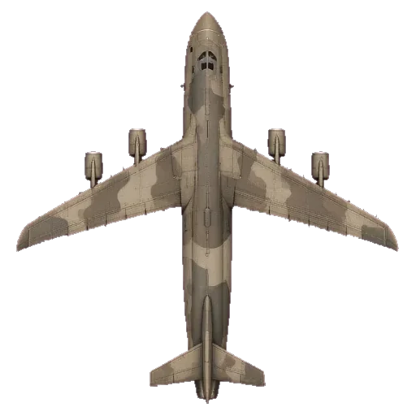
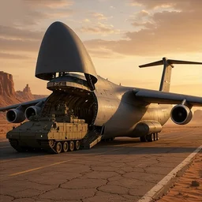

# Spec 140: C-5 Galaxy airlift (draft)

**Branch:** `feat/c5-galaxy-airlift`

**Status:** Requirements approved. Implementation validation is tracked in the [Galaxy handoff](../../docs/galaxy-handoff.md).

**Created:** 2026-11-21 (Europe/Berlin)

**Last Updated:** 2026-11-22 (Europe/Berlin)

**Source:** voice-call discussion on 2026-11-21 and Patrick’s answers on 2026-11-22

Implementation progress is tracked in the [Galaxy handoff](../../docs/galaxy-handoff.md). Approved artwork is listed under [Art assets](#art-assets).

---

## Overview

The C-5 Galaxy is a large air transport. Players load eligible ground vehicles by **weight**, fly to a destination, and **airdrop the cargo by parachute**.

Decided requirements from Patrick:

- Every vehicle definition gets a realistic **weight in metric tons**.
- Galaxy cargo is **weight-based**, not unit-count-based, with a **122 t** capacity. Any combination of vehicles that fits under the limit can be loaded.
- Cargo is **airdropped by parachute**.
- The Galaxy is a **large multi-tile unit**, in the same class of battlefield presence as the existing ships (for example the aircraft-carrier map sprite is 214×857).
- When parked it occupies space for **3 landing zones on the lower part of the airstrip** (decided 2026-11-21).
- It is **produced at the airstrip**.
- Map sprite and build-button art must be generated with **Grok Imagine only**, never ChatGPT or any other image model. Patrick picked the map and build button on 2026-11-21; those files are committed (see [Art assets](#art-assets)). **No construction icon** will be made. Parachute canopy art and takeoff and landing animation are described in [FR-012](#fr-012-flight-and-parachute-animation).

Patrick authorized ImageGen for the parachute canopy on 2026-11-22. The standing Grok Imagine rule applies to future game assets.

---

## User Stories

### User Story 1: A large airstrip transport

**Priority:** P0  
**As a** player  
**I want** to build a C-5 Galaxy at the airstrip  
**So that** I can move ground vehicles across the map by air

**Acceptance Criteria:**

- [ ] The C-5 Galaxy is a buildable air unit whose production building is the airstrip.
- [ ] It is visibly a large multi-tile unit on the battlefield, comparable in presence to ships such as the aircraft carrier (`public/images/map/units/aircraft_carrier_map.webp`, 214×857), not a 64×64 fighter-sized sprite at fighter scale.
- [ ] Selection, occupancy, pathing, takeoff, landing, and parking account for that large footprint. Parked, the Galaxy takes space for 3 landing zones on the lower part of the airstrip. Use a nominal 3×3-tile ground footprint and a render scale of about 3–4× the F-22, with the current draft at 3.5×.
- [ ] Implementation uses the committed Grok Imagine map sprite and build button listed under Art assets. There is no construction icon.

---

### User Story 2: Weight-based cargo

**Priority:** P0  
**As a** player  
**I want** to load any mix of vehicles whose weights add up to at most 122 t  
**So that** I can choose a few heavy vehicles or more lighter ones without a hidden unit-count cap

**Acceptance Criteria:**

- [ ] Every vehicle definition has a realistic weight property in metric tons.
- [ ] The Galaxy's cargo capacity is 122 t. Loading is allowed for any combination whose summed weight is less than or equal to 122 t.
- [ ] A vehicle that would exceed remaining capacity cannot be loaded, with clear player feedback.
- [ ] There is no separate maximum number of cargo vehicles. A single vehicle heavier than 122 t cannot be loaded.
- [ ] Only ground vehicles without cargo can board. Wrecks, aircraft, ships, and vehicles already carrying cargo are ineligible.

---

### User Story 3: Parachute airdrop

**Priority:** P0  
**As a** player  
**I want** to order a loaded Galaxy to a drop location and have the cargo descend under parachutes  
**So that** I can deliver vehicles into the field without a runway at the destination

**Acceptance Criteria:**

- [ ] The player can order a loaded Galaxy to airdrop its cargo at a target location.
- [ ] Vehicles leave the aircraft and descend on parachutes onto the battlefield (the visual treatment can be simple, but it must read as a parachute airdrop).
- [ ] Vehicles become ordinary controllable units after they have landed.
- [ ] The player picks an exact target tile. Drops use free, passable land within three tiles of the target. Water targets are rejected. Valid targets inside enemy bases are allowed.
- [ ] Only anti-air weapons can damage descending vehicles. Cargo aboard a destroyed Galaxy is destroyed and leaves wrecks on the ground. Vehicles already released continue descending.

---

### User Story 4: Approved art, not guessed art

**Priority:** P0  
**As a** player (and as Patrick, reviewing assets)  
**I want** the Galaxy's map sprite and build button to come from Grok Imagine and from my pick  
**So that** the new unit matches the game's art standard

**Acceptance Criteria:**

- [x] The committed map sprite and build button were generated with Grok Imagine only and picked by Patrick on 2026-11-21. There is no construction icon.
- [ ] Implementation wires those committed files (see [Art assets](#art-assets)), not placeholders and not a replacement generated by another model.
- [x] Takeoff, landing, and boarding have visible animations. Descent uses the dedicated canopy image and dynamic lines described in [FR-012](#fr-012-flight-and-parachute-animation).
- [ ] The same Grok Imagine rule applies to any future code-for-battle game-asset images.

---

## Functional Requirements

### FR-001: Weight property on every vehicle

**Priority:** P0  
**Description:** Every vehicle definition carries a realistic weight in metric tons. The property is part of the unit definition (not a one-off Galaxy table). Patrick approved the draft values in the [vehicle weight table](../../docs/vehicle-weights.md). Only eligible ground vehicles can board.

### FR-002: 122 t weight-based capacity

**Priority:** P0  
**Description:** Galaxy cargo capacity is 122 metric tons. Any combination of loadable vehicles whose weights sum to ≤ 122 t may be loaded. There is no unit-count capacity. A load that would exceed 122 t is rejected with clear feedback.

### FR-003: Parachute airdrop

**Priority:** P0  
**Description:** The player selects an exact target tile. Release vehicles one by one onto free, passable land within three tiles of the target. Reject water targets and release cargo over land. Allow valid tiles inside enemy bases. If a vehicle has no valid landing tile in range, keep it aboard and notify the player. The drop cannot be cancelled once release begins.

### FR-004: Large multi-tile unit

**Priority:** P0  
**Description:** The Galaxy is a large multi-tile unit, in the same size class on the battlefield as existing ships (aircraft carrier map sprite 214×857 is the reference example). It must not be implemented as a fighter-scale air unit with only a label change. When parked it occupies space for **3 landing zones on the lower part of the airstrip**. Use the committed 512×512 map sprite at about 3–4× F-22 render scale. Use a nominal 3×3-tile ground footprint for selection, collision, and taxi clearance.

### FR-005: Produced at the airstrip

**Priority:** P0  
**Description:** The airstrip is the sole production prerequisite. The Galaxy costs 4,000 and uses the standard cost-based build time. It has 300 HP, twice the F-22’s armour, the draft speed of 2.2, and enough fuel to fly 800 tiles without refuelling. It is unarmed. Enemy and LLM-controlled AI production are outside v1.

### FR-006: Approved Grok Imagine art

**Priority:** P0  
**Description:** Implementation must use the committed map sprite and build button listed under Art assets. Patrick picked them from Grok Imagine proposals on 2026-11-21. There is no construction icon. Do not replace these files with assets from another image model.

### FR-007: Game art provenance

**Priority:** P0  
**Description:** The Galaxy map sprite, build button, and future game-asset images use Grok Imagine. Patrick authorized Codex to create the canopy with ImageGen. There is no construction icon.

### FR-008: Save, sync, and determinism

**Priority:** P0  
**Description:** Cargo, drop state, and weights participate in save/load, multiplayer command sync, and state hashing. Late-join snapshots include vehicles already under parachutes. The cheat-spawn name is `c5`.

### FR-009: Player-facing cargo feedback

**Priority:** P1  
**Description:** Use the hovercraft’s cargo UI pattern to show what is aboard and how much of the 122 t capacity is used. Display weight in place of the hovercraft’s occupied-slot count.

### FR-010: User manual

**Priority:** P1  
**Description:** The user manual (`public/docs/user-documentation.html`) covers airstrip production, weight-based capacity, the hovercraft-style controls, airdrop rules, and cargo damage and destruction.

### FR-011: Boarding and grounded unloading

**Priority:** P0

**Description:** Match the hovercraft’s reciprocal left-click boarding controls. With an eligible ground vehicle selected, show the move-into cursor over a grounded Galaxy and board on left-click. Support the reciprocal flow when the Galaxy is selected and the player hovers and left-clicks an eligible vehicle. Animate vehicles approaching and boarding. Use the context menu on a free ground tile to cancel boarding or unload a grounded Galaxy. Use the selected tile as the disembarking vehicles’ gathering point.

### FR-012: Flight and parachute animation

**Priority:** P0

**Description:** Animate takeoff and landing. Use one dedicated canopy image without suspension lines. Render four parachutes per descending vehicle, initially one over each cargo corner. Draw each canopy’s lines from four fixed mounting points to a single attachment point on the cargo at its corresponding corner. The canopies slowly circle around the attached cargo as it descends. Account for wind direction during descent.

### FR-013: Cargo damage and wrecks

**Priority:** P0

**Description:** Cargo aboard the Galaxy takes no damage. If the aircraft is destroyed, destroy all cargo still aboard and leave wrecks on the ground. During descent, only anti-air weapons can damage vehicles. Released cargo keeps descending if the Galaxy is destroyed. Normal damage rules apply after landing.

### FR-014: Sounds and presentation

**Priority:** P1

**Description:** Include dedicated Galaxy sound effects in v1. The first-Galaxy milestone and landing-page mention are outside v1.

---

## Success Criteria

### SC-001: Capacity math
Combinations at exactly 122 t load; combinations above 122 t are rejected; a single vehicle above 122 t is rejected. No hidden unit-count cap denies a combination that is within 122 t.

### SC-002: Visible airlift loop
A player can produce a Galaxy at the airstrip, load vehicles, fly, and receive those vehicles on the ground after a parachute descent.

### SC-003: Battlefield scale
On the map, the Galaxy reads as a large unit in the ship size class, not as a slightly bigger fighter.

### SC-004: Art gate
Committed final map and build-button art is Grok Imagine work that Patrick picked on 2026-11-21. Implementation uses those files, not placeholders. There is no construction icon.

### SC-005: Persistence
A save taken mid-load or mid-drop restores the same cargo and drop state; multiplayer peers stay in sync.

---

## Art assets

Patrick picked the C-5 Galaxy art on 2026-11-21 (Europe/Berlin). Both committed images were generated with **Grok Imagine** only. **No construction icon** is included or planned.

| Role | Path | Measured size |
|---|---|---|
| Map sprite (top-down, nose-up, desert camo, option 4) | `public/images/map/units/c5_galaxy_map.webp` | 512×512 RGBA, kept at high resolution because the unit renders as a multi-tile ship-class aircraft |
| Sidebar / build button (tank-loading shot, option 2) | `public/images/sidebar/c5_galaxy_sidebar.webp` | 256×256 RGB, matching existing aircraft build buttons |
| Parachute canopy | `public/images/effects/c5_parachute_canopy.webp` | 192×99 RGBA, prepared at 18 logical pixels wide |

The four parachutes share the ImageGen canopy. The renderer draws the suspension lines in the game.

---

## Out of scope

- Implementing the unit, weights, or parachute simulation in a documentation-only change.
- Replacing the committed Grok Imagine map sprite or build button with assets from another image model.
- Adding a construction icon (Patrick did not want one).

---

## References

- Existing large unit art: `public/images/map/units/aircraft_carrier_map.webp` (214×857)
- Committed Galaxy art: `public/images/map/units/c5_galaxy_map.webp` (512×512), `public/images/sidebar/c5_galaxy_sidebar.webp` (256×256)
- Existing unit-count transports, for contrast only: hovercraft `transportCapacity` 4, vehicle ferry `transportCapacity` 10, in `src/config.js`
- Airstrip production patterns: F-22 (`f22Raptor`) in `src/production/techTree.js` and `skills/new-unit/SKILL.md`
- Standing art rule, 2026-11-21: all new code-for-battle game-asset images are generated with Grok Imagine only
