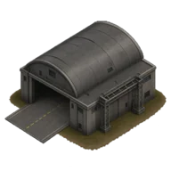
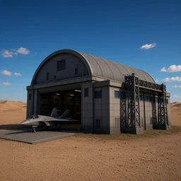

# Spec 141: Plane Factory

The Plane Factory is an advanced fighter assembly facility. Its card appears after **Aerospace Engineering**. Queuing and placement require an owned, living Technology Research Center, an Airstrip, and the standard construction chain.

| Footprint | Cost | Power draw | HP | Armor | Limit |
| --- | ---: | ---: | ---: | ---: | ---: |
| 3×3 | $5,500 | 120 | 500 | 2 | 1 per player |

The standard one-yard timer is 4.125 simulation seconds at normal power. Once placed, the factory multiplies F-22 and F-35 assembly speed by 1.25 for its owner. It applies when a job starts and does not restamp active jobs. Selling or losing the factory removes the boost for future jobs. Losing an Airstrip or the Research Center does not turn off an existing factory; aircraft still need the usual eligible producers.

F-22s continue to spawn at Airstrips. F-35s retain existing Airstrip and Helipad production. The factory supplies assemblies and has no runway. C-5 Galaxy and Apache production stay unchanged. Scripted opponents do not independently purchase research or build this tier.

Patrick approved map option 4 and sidebar option 5 on 2026-11-21. These are the [map sprite](../../public/images/map/buildings/plane_factory_map.webp) and [build button](../../public/images/sidebar/plane_factory_sidebar.webp).

See [Technology Research Center](../139-technology-center/spec.md) for the shared unlock and placement rules.
