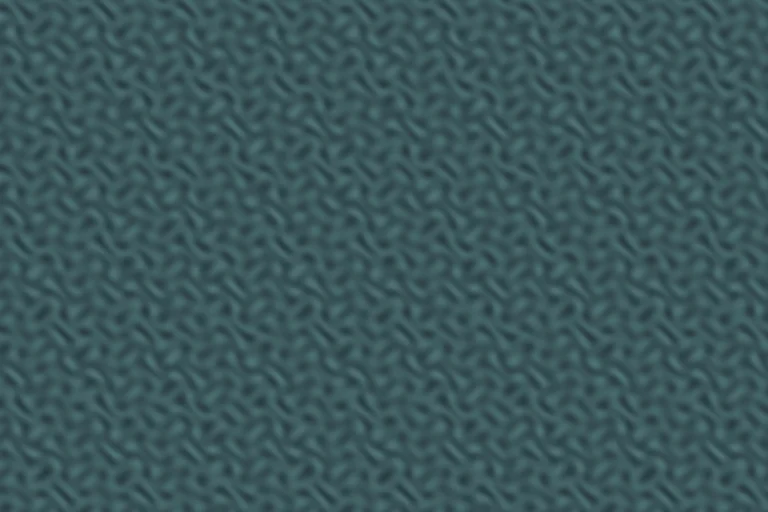
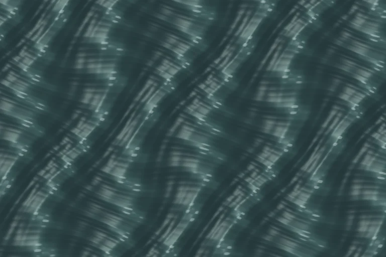

# Ocean-inspired water shading

## Rendering contract

- WebGL and WebGPU use equivalent analytic wave and lighting equations for animated water. Four directional wave bands are bent by two slow cross swells; analytic slopes drive sun glints and diffuse lighting, with Fresnel sky reflection and sparse breaking-crest foam.
- World coordinates are logical map pixels. Camera movement, tile boundaries, SOT overlap and canvas density must not change the phase at a fixed world position and time.
- Keep the existing retained water geometry, terrain masks, layer order and CPU fallback. Shading must not paint opaque land or change gameplay simulation, pathfinding, map topology or randomness.
- Tone, saturation and zoom remain adjustable. Saturation zero applies to the whole surface, including glints and shoreline tint. Waves that are smaller than a pixel fade into roughness to avoid sparkling aliasing at extreme zoom.
- Keep derivatives in uniform fragment control flow before clipping/discard. Compile both shaders during the existing renderer preparation lifecycle.

## Reference and licensing

Inspired by https://github.com/Noniv/web-ocean at
`a07c7fd522ef0a897601c114f927a49d93d95520`, specifically its multi-scale slopes,
anisotropic sun glitter, Fresnel reflection and foam. The small `fresnelWater`
function adapts the upstream WGSL function. The full upstream MIT license,
including Copyright (c) 2026 Maksymilian Dendura, is preserved in a legal source
comment and `public/licenses/web-ocean-MIT.txt`. `public/licenses/README.md`
records provenance and scope. No demo assets, FFT simulation, atmospheric
renderer, mesh or persistent foam textures are imported.

## Hot-path budget

The shader executes once per covered water fragment per frame. A full-water
1440×1000 viewport at DPR 2 covers 5.76 million fragments/frame, or 432 million
fragments/second at 75 FPS, plus the existing one-pixel tile overlap. The six
analytic bands therefore represent up to 2.592 billion band evaluations/second
before overlap on that worst case. This work is independent of entity count:
there are no new per-entity loops, extra draw passes, texture uploads, CPU wave
simulation or per-frame shader allocations. Existing chunk/instance buffers are
retained as camera/time changes. Four wave bands and two bending phases are
computed with vector operations in the existing fragment pass.

## Validation

The deterministic browser fixture executes the real renderer and reads pixels,
checking animation, fixed-time camera invariance, opacity, color controls,
zoom response, filtering at extreme zoom, DPR 1/3 equivalence, SOT clipping,
retained topology and WebGL/WebGPU agreement. Optional benchmark coverage records
full-water DPR-2 scrolling, frame-time distribution, CPU submission, GPU timing
availability, heap before/after and topology upload bytes.

```sh
npm run lint:fix:changed
npm run lint
npm run test:unit
npm run test
npm run test:e2e -- tests/e2e/oceanWaterRendering.test.js tests/e2e/proceduralWaterRendering.test.js --project=chromium --workers=1 --reporter=line
OCEAN_WATER_BENCHMARK=1 npm run test:e2e -- tests/e2e/oceanWaterRendering.test.js --grep E00204 --project=chromium --workers=1 --reporter=line
PERF_RENDERING_PIPELINE=1 npm run test:e2e -- tests/e2e/renderingPipeline75Fps.test.js --project=chromium --workers=1 --reporter=line
npm run build
```

### Performance acceptance

**Outstanding:** certify 75 presented FPS on qualifying reference hardware with
an actual >=75 Hz display, including cold first traversal, repeated full-map
scrolling, selected layered units, firing effects, movement and realistic entity
counts. The headless cloud environment uses ANGLE/SwiftShader software rendering
and cannot certify the 13.333 ms deadline. Do not treat a relative improvement,
unit tests, pixel tests or a software-only benchmark as performance acceptance.
No resolution, cadence or quality reduction is used to satisfy the gate.

### Matched visual samples

The following captures use the same 768×512 logical viewport, DPR 1, camera
(128,128), 1200 ms animation time, zoom 0.2, tone 0.35 and saturation 0.4. They
are generated by the game's WebGL renderer and encoded as WebP at quality 85.

| Original | Ocean-inspired |
|---|---|
|  |  |

### Cloud validation results (2026-10-19)

Lint and the production build pass. Before the final CSS-only rebase, the full
unit suite passed 5,322/5,322 and the combined unit/integration suite passed
5,408/5,408. Focused Chromium browser checks pass 7/7 (the opt-in performance
case is skipped by default); the performance case also passes independently on
both the original and changed renderers. A production-bundle search finds the
upstream copyright notice, and the deployed license file matches the upstream
MIT text byte-for-byte.

[Machine-readable diagnostic evidence](../docs/changes/2026-10-19-ocean-water-benchmarks.json)
contains frame distributions, CPU submission/update/render measurements, heap
samples, software GPU timing, entity counts and errors. All measurements use
ANGLE Vulkan SwiftShader, headless Chromium, DPR 2 and a 1440×1000 viewport.
They cannot certify presented FPS. GC pause duration was not available; heap
samples show collections occurred and no duration claim is made.

| Full-water scrolling, 120 renders | Original | Changed |
|---|---:|---:|
| Observed FPS | 4.00 | 2.42 |
| Frame p95 / p99 / max (ms) | 300.1 / 383.3 / 916.7 | 650.0 / 933.3 / 2583.2 |
| Missed 13.333 ms deadlines / frame intervals | 119 / 119 | 119 / 119 |
| CPU submission mean / p95 (ms) | 0.317 / 0.900 | 0.302 / 0.700 |
| Last available software GPU query (ms) | 300.04 | 306.42 |
| Topology upload bytes before / after scrolling | 278528 / 278528 | 278528 / 278528 |
| Heap before / after (bytes) | 27972485 / 4066972 | 28002091 / 4706814 |

The shader costs more in this software worst case: **this is not a performance
pass**. Hardware performance and the strict 75 FPS gate remain outstanding; the
Hardware verification is delegated to Patrick on `dev` or a Deploy Preview; this does not block the authorized dev workflow. CPU submission and unchanged upload totals confirm retained
geometry is reused, but do not establish an acceptable total GPU/frame cost.

The existing combat traversal diagnostic used seed 11, a 100×100 map, 120
initial units, 8 selected player units, movement/firing/explosions, 2400 px/s
scrolling and a 15-second measurement. Both completed a full route cycle
(the route contains two laps for cold/repeated traversal), with no page errors.

| Combat traversal | Original | Changed |
|---|---:|---:|
| Units sampled | 117–120 | 119–120 |
| Observed FPS | 0.79 | 1.44 |
| Frame p95 / p99 / max (ms) | 4299.8 / 4299.8 / 4299.8 | 1733.3 / 1933.2 / 1933.2 |
| Missed deadlines / frame intervals | 12 / 12 | 22 / 22 |
| CPU update mean (ms) | 69.98 | 43.05 |
| CPU render mean (ms) | 312.11 | 51.84 |
| Heap sample range (MiB) | 94.23–107.53 | 97.68–115.94 |

The low software FPS and small sample counts make these combat measurements
unsuitable for claiming a hardware improvement or regression. A qualifying
hardware run is still required, including GPU tails and GC evidence.

Exact combat commands (servers ran the original checkout on port 5174 and this
branch on port 5173; `/workspace/scratch/water-chromium` wrapped `/usr/bin/chromium`
with `--no-sandbox --enable-unsafe-swiftshader --use-angle=swiftshader
--enable-features=Vulkan --use-vulkan=swiftshader --enable-unsafe-webgpu`):

```sh
PLAYWRIGHT_EXECUTABLE_PATH=/workspace/scratch/water-chromium PERF_BASE_URL=http://127.0.0.1:5174 PERF_SCENE=traversal PERF_UNITS=120 PERF_DURATION_MS=15000 PERF_SCROLL_SPEED=2400 node scripts/performance/microstutterBenchmark.mjs /workspace/scratch/water-game-before.json
PLAYWRIGHT_EXECUTABLE_PATH=/workspace/scratch/water-chromium PERF_BASE_URL=http://127.0.0.1:5173 PERF_SCENE=traversal PERF_UNITS=120 PERF_DURATION_MS=15000 PERF_SCROLL_SPEED=2400 node scripts/performance/microstutterBenchmark.mjs /workspace/scratch/water-game-after.json
```

The focused browser/performance commands above were run with a local Playwright
config importing the repository config and overriding `launchOptions` to use
that Chromium wrapper, `baseURL` from `PLAYWRIGHT_BASE_URL`, `webServer: undefined`,
`workers: 1`, and `reporter: 'line'`. The full-water diagnostic was run serially
on ports 5174 and 5173 with `OCEAN_WATER_BENCHMARK=1` and `--grep E00204`.

### Legacy browser fixture limits

A broader organic-terrain browser run also encountered unprepared/null texture
fixtures. The representative failures E00081 (missing biome texture during
`drawBiome`) and E00088 (`null.decode()`) reproduce on the untouched baseline
checkout. They are outside the changed shader pass and have not been hidden or
weakened. The focused water suite replaces its own obsolete sampling path with
fixed-time real-renderer readback and uses the live game renderer instance.
The full unrelated Playwright suite was not run; hardware/mobile, multiplayer,
and the remaining gameplay scenarios are not certified by this PR.

### User-directed validation handoff

Patrick instructed the agent to stop testing and to never run GPU/performance
tests without a hardware GPU. All active tests were stopped; no further tests
were run. The post-rebase full-suite repeat was interrupted, so only the earlier
completed runs are reported as passing. `AGENTS.md` now requires verified
hardware GPU availability and otherwise delegates performance verification to
Patrick on `dev` or a Deploy Preview. Earlier software diagnostics above remain
a historical record and must not be repeated under the new rule.
